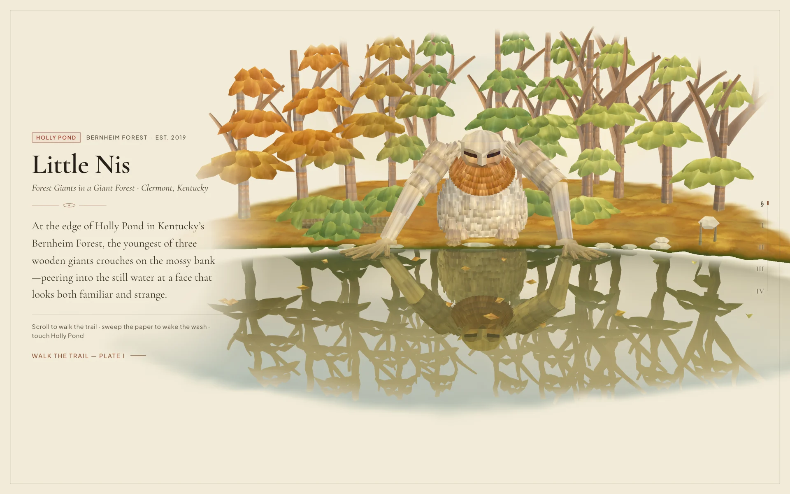
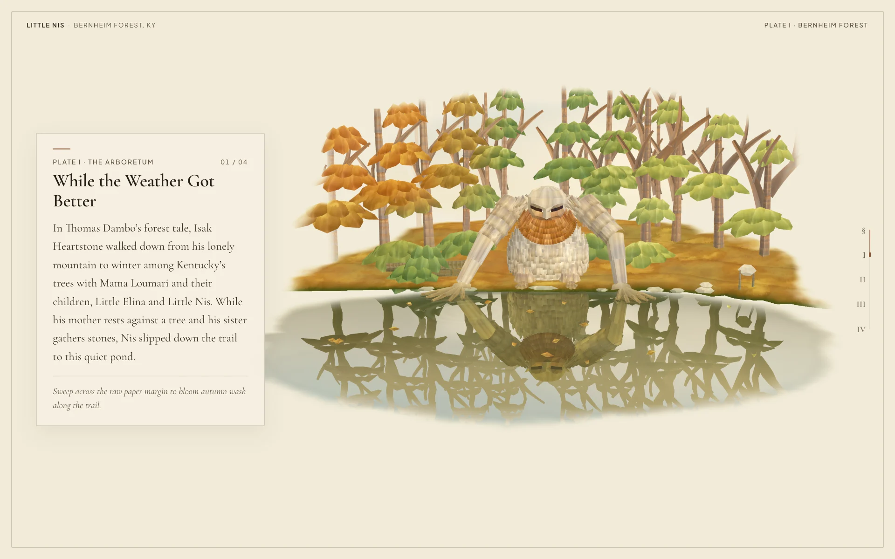
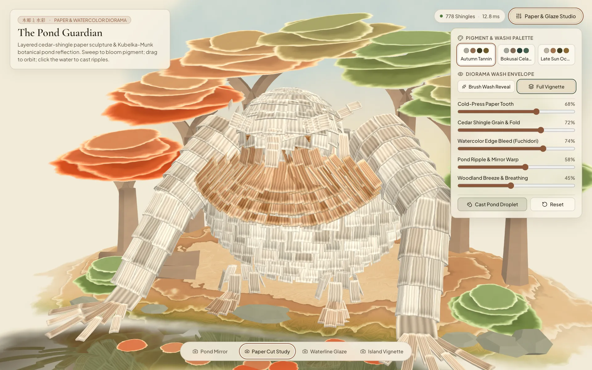
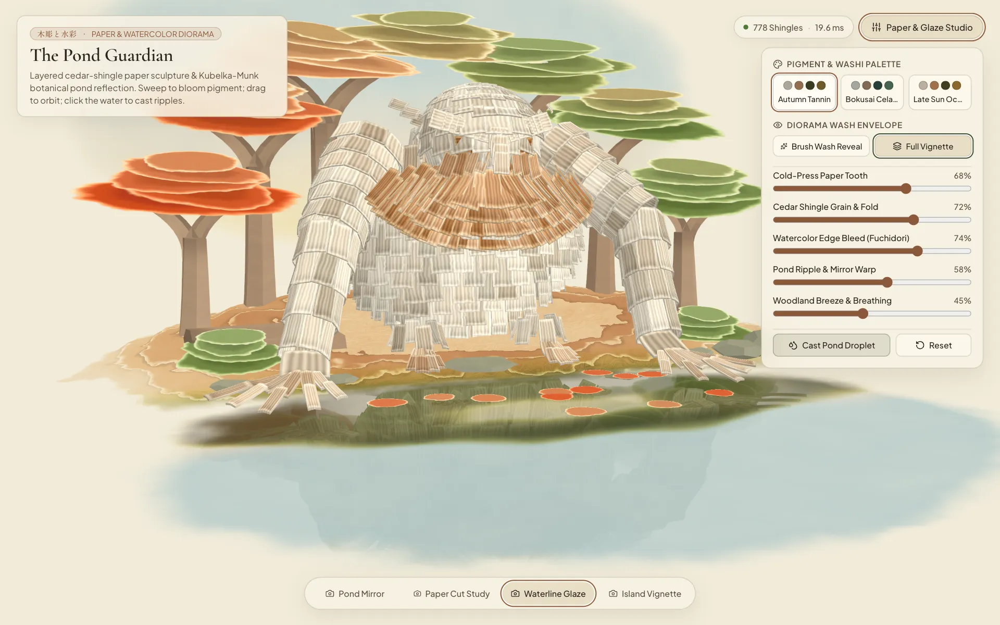

# Paper-Wrapper Worlds — Little Nis (Bernheim Forest)

A scroll-choreographed **Three.js `r187` `WebGPURenderer` + `TSL` (`three/tsl`)** folklore folio telling the story of **Little Nis**—the curious young wooden giant built by Thomas Dambo from reclaimed regional wood beside Holly Pond in Kentucky’s **Bernheim Arboretum and Research Forest** (*Forest Giants in a Giant Forest*, 2019)—rendered in folded cold-press Washi paper and multi-layer watercolor washes.

## Quick Start

Requires Node.js `20+`.

```bash
git clone https://github.com/andrewvoirol/paper-wrapper-worlds.git
cd paper-wrapper-worlds
npm install
npm run dev
```

## Trail Stops & Folio Plates

| Trailhead — Little Nis at Holly Pond | Plate I — While the Weather Got Better |
| :---: | :---: |
|  |  |
| **Plate II — Pieced from Forgotten Wood** | **Plate III — Hands on the Mossy Bank** |
|  |  |

## How It Works

- **Walk the Bernheim Trail**: Scroll down the Washi sheet (or select `§` and `I–IV` along the right spine) to follow Little Nis’s story from the Bernheim Arboretum trail (`While the Weather Got Better`) up to his reclaimed pallet and scrap-wood ribs, down to his ten splayed wooden hands on the bank of Holly Pond, and into his twin reflection below.
- **Sweep to Wake the Wash**: Move the brush cursor across the raw paper margin to bloom autumn pigment and bast-fiber detail along the edge of the woodland clearing.
- **Drag to Orbit & Touch Holly Pond**: Drag anywhere on the diorama to turn Little Nis in the clearing light, or click and sweep across the pond to send capillary ripples through his reflection.

All solid geometry (the sculpted origami face and arms, 776 tucked wooden courses, radially fanned russet collar, 6-layer torn woodland island, and pleated birch crowns) renders in a unified TSL node pipeline (`paperCraftShader.ts`, `watercolorPondShader.ts`). Pigment glazes evaluate **Kubelka-Munk 2-flux radiative transfer** ($\coth(b S d)$) directly against warm unbleached Washi paper (`#f2ebd9`) with sinuous bast-fiber FBM grain and evaporative contact-line pinning (*Fuchidori* `縁取り`).

## Tech Stack

| Layer | Technology |
| :--- | :--- |
| **Renderer** | Three.js `0.187.0` (`WebGPURenderer`) |
| **Shading Language** | Three Shading Language (`three/tsl`) |
| **UI & Typography** | React `19.3` · Cormorant Garamond & Plus Jakarta Sans |
| **Build & Test** | Vite `8.3` + TypeScript `7.0` + Vitest `5.1` |
